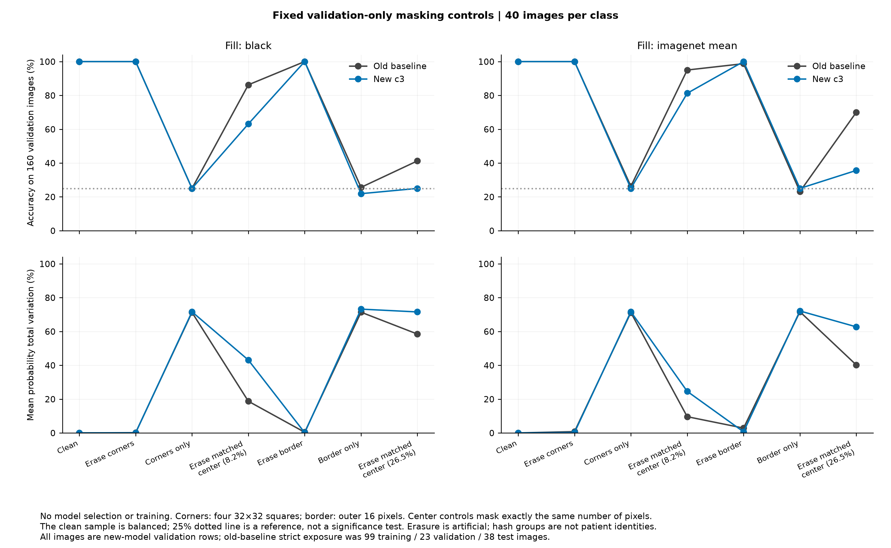
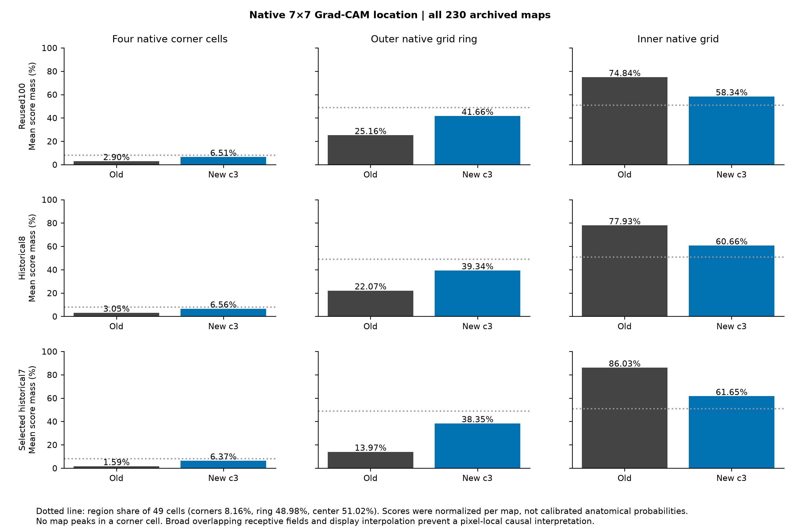

# TKS Build

## Did brain-MRI classifiers rely on image corners?

I built a controlled corner-and-border reliance audit for two existing brain-MRI image classifiers, following my Learn work on Grad-CAM. I was concerned that models might learn image-source artifacts instead of meaningful anatomy. The completed audit compared original predictions with corner, border and equal-area central masking, and inspected archived native Grad-CAM maps.

**The controls did not support dominant input-corner reliance by either model.** This is evidence from a development sample, not proof that every shortcut is absent or that the models are clinically reliable. The Build investigated a suspected failure mode; it did not establish or “fix” a corner defect.

[Learn article](https://medium.com/@armankazi17033/can-grad-cam-reveal-shortcuts-in-brain-mri-classifiers-da2b4cb66688) · [Methods](docs/METHODS.md) · [Results](results/control_results.csv) · [Limitations](docs/LIMITATIONS.md) · [Reproduction](docs/REPRODUCIBILITY.md)

## What I built and ran

- Compared the frozen old baseline with **candidate 3**, the validation-selected stage-only model with seed `20261012`. Both used MobileNetV3-Large and 224×224 RGB inputs with ImageNet normalization.
- Ran 13 fixed conditions per model on **160 new-model validation images**, 40 per class and one per prepared hash group: 4,160 exported probability rows and 26 aggregate metric records in the original audit.
- Tested removal of the four 32×32 corners, retention of corners only, removal of the outer 16-pixel border, retention of the border only, and equal-area central erasures. Each used black and ImageNet-mean fills, plus clean inputs.
- Reused and hash-verified **230 archived native 7×7 maps covering 115 cases**. No new inference on original100 or held-out test cases occurred in this audit. No training or checkpoint changes occurred.

The models were trained with labeled MRI classes and cross-entropy: **supervised learning**. The corner audit itself performed inference only. The 160 images were separated by **hash group, not patient identity**. Old-model historical exposure was 99 training / 23 validation / 38 test images, so old/new comparisons are descriptive. The source folder name `round2_corner_audit` does not mean this comparison used a later Round2 model. A separately labeled [robustness follow-up](docs/FOLLOWUP.md) documents related mitigation work; none of its results are substituted into the core audit below. The October 22 evaluation is outside this package.

## Results

Accuracy on the fixed 160-image validation sample:

| Condition | Old black | Old mean | Candidate 3 black | Candidate 3 mean |
|---|---:|---:|---:|---:|
| Clean | 100% | 100% | 100% | 100% |
| Erase corners | 100% | 100% | 100% | 100% |
| Corners only | 25% | 26.25% | 25% | 25% |
| Erase equal-area center (8.16% pixels) | 86.25% | 95% | 63.125% | 81.25% |
| Erase border | 100% | 98.75% | 100% | 100% |
| Border only | 25.625% | 23.125% | 21.875% | 25% |
| Erase equal-area center (26.53% pixels) | 41.25% | 70% | 25% | 35.625% |

“Mean” means ImageNet-mean fill, not a statistical mean across runs. The clean condition is repeated in the table for comparison; it has no fill. Each percentage comes from one fixed sample. The 25% level is a balanced four-class reference, not a significance test.



Candidate 3's mean probability total variation was approximately 0.0005–0.0027 after corner erasure and 0.0013–0.0066 after border erasure. Central erasures caused much larger changes and harmed candidate 3 more than the old model; the audit does not establish uniform robustness superiority.

On the reused original100 maps, mean native corner score mass was **2.90% old / 6.51% candidate 3**, versus 8.16% of grid area. No maximum lay in a native corner cell among all 230 maps. Per-map normalized scores and broad overlapping receptive fields prevent a pixel-local or biological interpretation.



## What this taught me

A colored corner in an upsampled heatmap is a reason to investigate, not evidence that corner pixels cause the prediction. Comparing location, fill and equal-area controls changed the interpretation: central content mattered more in this audit. Related mitigation work used supervised robustness training with conservative background changes and validation guards; its [separate development results](docs/FOLLOWUP.md) do not prove source artifacts were removed. The hypothetical added-corner-marker experiment from the Learn article remains a different, proposed test.

## Read and verify this repository

```bash
python3 scripts/verify_package.py
```

This command needs only the Python standard library. It verifies packaged hashes, source syntax, aggregate metric consistency, documented sample counts, CSV agreement, Markdown links and exclusion rules. It does **not** run a model or independently regenerate 4,160 predictions. The original audit's wider verification report is preserved separately from checks performed while packaging.

| Location | Contents |
|---|---|
| `results/` | Aggregate metrics, a compact CSV, protocol, native-map cohort summaries and a derived aggregate-only summary |
| `figures/` | Original aggregate plots in PNG and PDF; no MRI images |
| `source_snapshot/` | Exact audit code and required helper snapshots; optional historical Grad-CAM source for provenance |
| `docs/` | Methods, limitations, reproduction, dataset access and references |
| `provenance/` | Per-file source hashes, omitted-input manifest, historical verification and current package checks |
| `.github/workflows/` | Lightweight package verification only |

## Data, reproducibility and scope

No raw MRI images, individual-case predictions, native-map arrays, model weights or credentials are included. Full inference reproduction requires authorized original inputs listed in [the omitted-input manifest](provenance/omitted_inputs_manifest.json). [Reproduction instructions](docs/REPRODUCIBILITY.md) explain that dependency explicitly. This repository can be inspected and its aggregates checked without those inputs; it is not a self-contained clinical dataset or diagnostic tool.

The original research repository is [Dementia-Image-Classification](https://github.com/TailsOS-hack/Dementia-Image-Classification), locally still named `Neuro-Radiology-Database`. These materials were copied from its working tree; some audit evidence was untracked, so [file hashes](provenance/source_manifest.json), rather than the source Git commit alone, identify this snapshot. The original repository was preserved.

See [NOTICE](NOTICE) for source and redistribution boundaries. No new inference, training or expensive experiments were performed to create this package.
